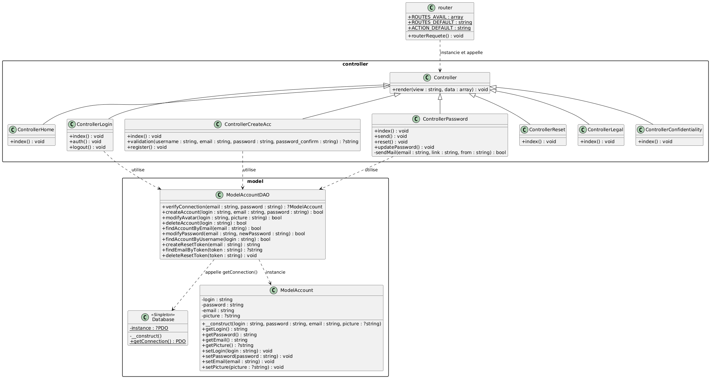

## 🔡 Techdle (SAEdeuxiemeA)

Ce projet est une application web multijoueur inspirée du jeu **Wordle**, développée dans le cadre de notre SAE de 2ème année de BUT Informatique.

Le but du jeu est de deviner un mot caché (basé sur un dictionnaire de termes informatiques) avec un nombre d'essais limité.

**Fonctionnalités :**
* **Modes de jeu :** Mode "Daily" (mot du jour unique) et Mode "Training" (tirage aléatoire infini).
* **Architecture :** Construit en **PHP** et suit un modèle **MVC**.
* **Base de données :** Données gérée sous **PostgreSQL**.
* **Front-end :** Logique de jeu en temps réel gérée en **JavaScript** avec une interface en **CSS**.
* **Déploiement :** Base de données et application hébergées sur **Alwaysdata**.

## 👥 L'équipe et les rôles (Méthodologie Scrum)

Le projet a été développé de manière Agile, avec des Sprints, un Product Backlog et une décomposition en Issues sur GitHub.

| Membre | Rôle |
| :--- | :--- |
| **Anna** | **Scrum Master & Développeuse** |
| **Mélissa** | **Product Owner & Développeuse** |
| **Tommy** | **Développeur** |
| **Kalvin** | **Développeur** |

## 🤖 Utilisation de l'intelligence artificielle

| Nom de l'IA utilisée | Pourquoi l'avoir utilisée | Qui l'a utilisée |
| :--- | :--- | :--- |
| Gemini | Pour corriger mes vues | Anna |
| Claude & Gemini | Pour comprendre comment former les modèles et corriger | Ombeline & Mélissa |
| Claude | Correction des erreurs/aide | Tommy |
| Claude | Utiliser alwaysdata | Ombeline & Mélissa |
| Claude | Récupération Mot de passe | Tommy |
| Gemini | Générer le CSS de chaque page | Anna |
| Gemini | Validation W3C | Anna |
| Gemini | Aide à la syntaxe PlantUML | Mélissa |

## ℹ️ Utilisation d'autres sources hors IA

| Nom d'autre source | Pourquoi l'avoir utilisée | Qui l'a utilisée |
| :--- | :--- | :--- |
| [Doc php](https://www.w3schools.com/php) | En vérification/trouver ce dont on avait besoin | Tous |
| Olivier Gerard | parce que c'est le GOAT | Tous |
| [MVC1](https://bpesquet.developpez.com/tutoriels/php/evoluer-architecture-mvc/) | Utilisé comme guide pour la MVC/Contrôleurs | Tommy |
| [MVC2](https://medium.com/@dilankayasuru/budling-a-minimal-mvc-application-in-vanilla-php-a-step-by-step-guide-75c185604c65) | Utiliser comme guide pour la MVC/Contrôleurs | Tommy |
| [MVC3](https://dyma.fr/blog/introduction-au-mvc-avec-php/) | Utilisé comme guide pour la MVC/Contrôleurs | Tommy |
| [MVC4](https://laconsole.dev/formations/php/design-pattern-mvc) | Utilisé comme guide pour la MVC/Contrôleurs | Tommy |
| [Mail](https://blog.crea-troyes.fr/3619/comment-verifier-et-valider-une-adresse-mail-en-php/) | Vérifier si l'élément est un email| Tommy |
| [Login](https://blog.crea-troyes.fr/4650/coder-un-formulaire-de-login-securise-en-php-tutoriel/#aioseo-etape-1-creation-de-la-base-de-donnees) | Idée pour comment ça marche une page de login| Tommy |
| [Password](https://phppot.com/php/php-forgot-password-recover-code/) | Idée pour comment ça marche une système d'oublie de mot de passe | Tommy |
| [Documentation officielle PHP – PDO](https://www.php.net/manual/fr/book.pdo.php) | Utilisé pour l'implémentation du DAO et la sécurité contre les injections SQL | Mélissa |
| [PlantUML](https://plantuml.com/fr/) | Génération de diagrammes UML | Mélissa |
| [Documentation PlantUML – Diagrammes de classes](https://plantuml.com/fr/class-diagram) | Syntaxe des normes UML | Mélissa |
| [Documentation PlantUML – Diagrammes de séquence](https://plantuml.com/fr/sequence-diagram) | Syntaxe des normes UML | Mélissa |
| [Documentation officielle PostgreSQL](https://www.postgresql.org/docs/) | Utilisé pour la conception de la base de données | Mélissa |
| [Refactoring.guru – Singleton](https://refactoring.guru/fr/design-patterns/singleton) | Modélisation et implémentation du pattern Singleton | Mélissa |

## 📊 Architecture logicielle (UML)

### Diagramme de classes

